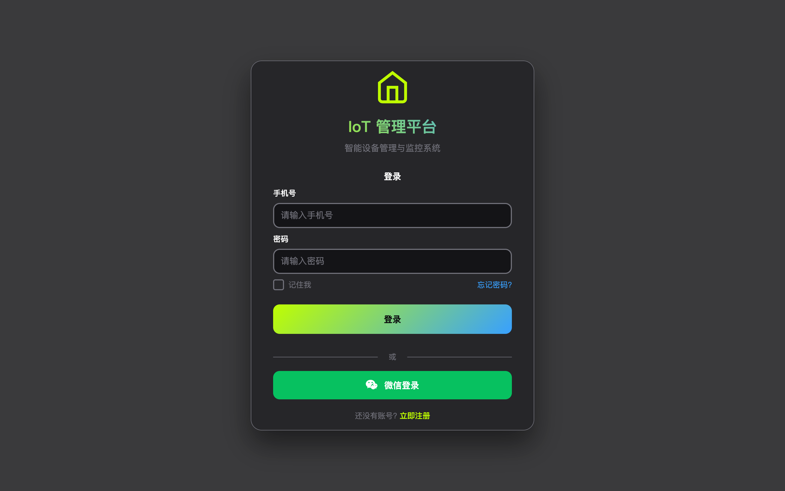
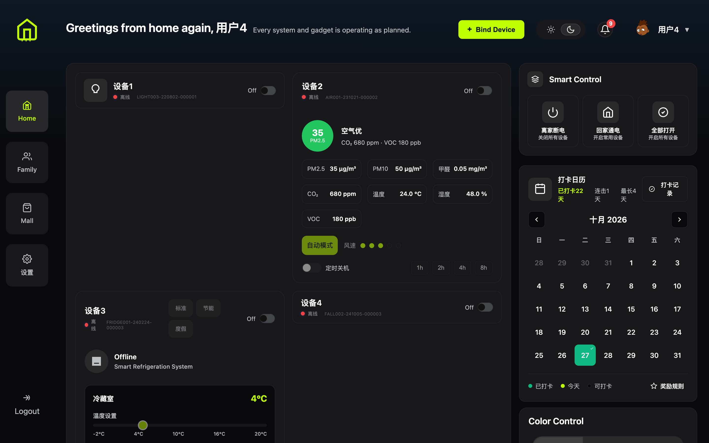
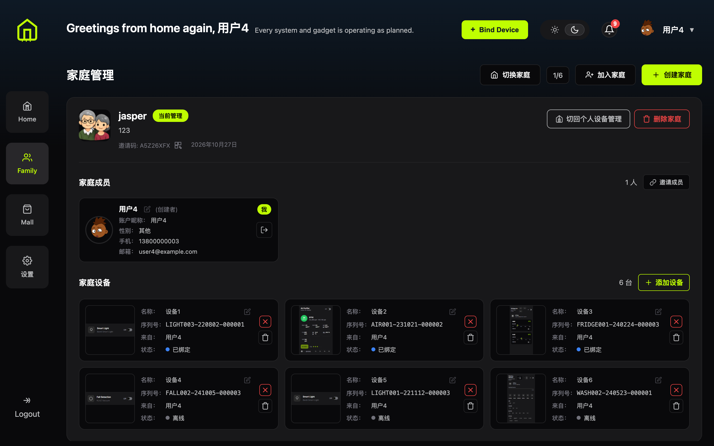
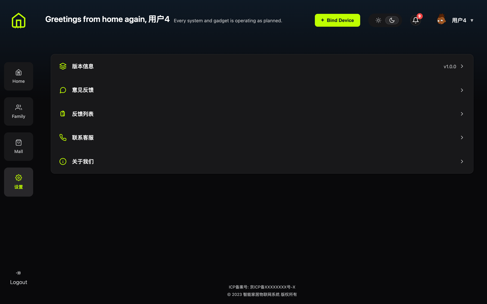

# IoT 设备管理平台

基于 Vue 3 的物联网设备管理与监控前端，支持设备状态展示、远程控制、家庭共享与实时消息推送。

## 界面预览

### 登录页



### 设备首页

设备卡片、智能控制面板、打卡日历与颜色控制集中展示，实时同步设备状态。



### 家庭管理

支持创建/切换家庭、邀请成员、查看并管理家庭内的共享设备。



### 设置

版本信息、意见反馈、联系客服与关于我们。



## 功能特性

- **账号体系**：手机号密码登录/注册，密码经 RSA 加密后传输；支持记住账号、微信扫码登录
- **设备管理**：设备卡片按型号动态渲染（空气检测、冰箱、风扇、插座、摄像头、洗衣机等），支持修改名称、解绑设备
- **远程控制**：卡片内直接开关设备、调节档位与参数
- **智能控制**：一键离家断电、回家通电、全部打开
- **家庭共享**：创建家庭、邀请码添加成员、家庭设备统一管理
- **打卡日历**：每日打卡累计积分，查看连续打卡与奖励规则
- **消息通知**：设备告警与系统消息角标提醒
- **主题切换**：日间/夜间模式一键切换
- **实时通信**：通过 WebSocket / MQTT 获取设备状态，断线自动重连

## 技术栈

| 类别 | 技术 |
| --- | --- |
| 框架 | Vue 3（Composition API） |
| 路由 / 状态 | Vue Router 4 / Pinia |
| UI 组件 | Element Plus |
| 构建工具 | Vite 5 |
| 网络请求 | Axios |
| 图表 | ECharts |
| 实时通信 | MQTT.js（WebSocket）、原生 WebSocket |
| 其他 | node-forge（RSA 加密）、qrcode（二维码生成） |

## 快速开始

### 环境要求

- Node.js 18+
- npm 9+

### 本地开发

```bash
npm install
npm run dev
```

浏览器访问 `http://localhost:5173`。

### 环境配置

接口地址在 [src/config/env.js](src/config/env.js) 中配置：

```javascript
const isDev = true // true: 使用 Vite 代理请求；false: 直连 baseUrl
baseUrl: 'http://212.129.243.155/api'
mqttWsUrl: 'ws://212.129.243.155:8083/mqtt'
```

`isDev = true` 时，`/api` 请求由 Vite 代理转发（见 [vite.config.js](vite.config.js)），避免跨域问题。

## 构建与部署

### 本地构建

```bash
npm run build     # 产物输出到 dist/
npm run serve     # 本地预览构建产物
```

### Docker

```bash
docker build -t iot-web .
docker run -d -p 8080:80 --name iot-web iot-web
```

访问 `http://localhost:8080`。镜像使用 Nginx 托管静态资源，并通过 [nginx.conf](nginx.conf) 将 `/api/` 代理到后端服务。

### GitHub Actions

推送 `main` 分支（或在 Actions 页面手动触发）会自动构建多架构镜像并推送到 Docker Hub：

- `main`：跟随最新提交，用于测试环境
- 提交 SHA 前 7 位：不可变版本，用于生产发布与回滚

## 项目结构

```
src/
├── api/            # 接口封装（认证、设备、家庭、积分、反馈等）
├── cards/          # 各设备类型卡片组件
├── components/     # 通用组件（智能控制、打卡日历、颜色控制等）
├── composables/    # WebSocket 管理等组合式函数
├── config/         # 环境配置
├── router/         # 路由与登录守卫
├── stores/         # Pinia 全局状态（认证、设备、家庭、消息）
├── styles/         # 主题色变量
├── utils/          # 请求、MQTT、WebSocket、设备映射等工具
└── views/          # 页面（登录、首页、家庭、商城、设置）
```

## 页面路由

| 路径 | 说明 |
| --- | --- |
| `/login` | 登录 / 注册 |
| `/home` | 设备首页 |
| `/family` | 家庭管理 |
| `/mall` | 商城（开发中） |
| `/settings` | 设置 |

除登录页外，其余页面均需登录后访问。
